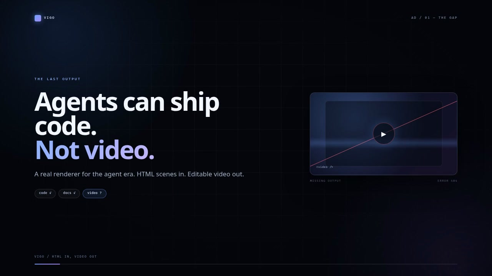
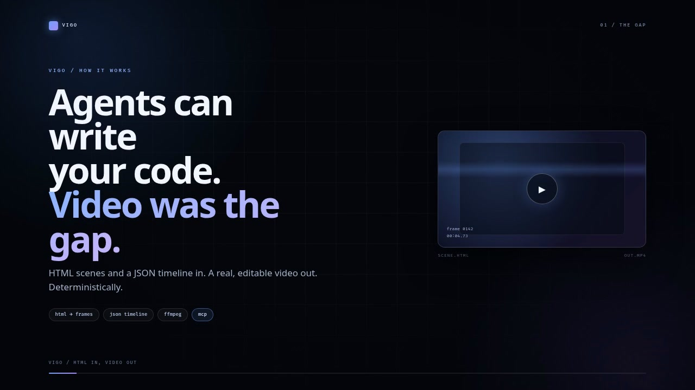

<div align="center">
  

  # vigo

  **Lightweight, agent-first video creation and editing.**
  HTML scenes in, deterministic MP4 out, JSON timeline in the middle. Small CLI, 14 MCP tools, no GUI, no database.

  [](LICENSE)
  
  ](https://black-api.github.io/vigo/)
  

  **[Website](https://black-api.github.io/vigo/)** · **[npm](https://www.npmjs.com/package/vigo-video)** · [Ad + explainer](#watch-it-work) · [Agent skill](skills/vigo/SKILL.md) · [Issues](https://github.com/black-api/vigo/issues)
</div>

```bash
vigo html2video scene.html -o scene.mp4 --duration 6
vigo render examples/hello/vigo.json -o out/hello.mp4
```

## Watch it work

Two real deliverables, rendered by vigo itself:

[](renders/vigo-ad.mp4)

- **[vigo-ad.mp4](renders/vigo-ad.mp4)** — 33s product ad, music bed, no screen recording.
- **[vigo-explainer.mp4](renders/vigo-explainer.mp4)** — 2m51s narrated walkthrough. Real spoken narration (Edge neural TTS) mixed under a generated synth bed.

[](renders/vigo-explainer.mp4)

Sources are in [`examples/ad`](examples/ad) and [`examples/explainer`](examples/explainer); the narration script and per-scene timings are in each `script.md`.

```bash
node scripts/build-demos.mjs              # regenerate voice, scenes, music, and both videos
node scripts/build-demos.mjs --manifest-only   # refresh posters + renders/manifest.json only
```

`renders/manifest.json` records the final durations, codecs, and source projects.
The rendered MP4s live in the repo, not in the npm tarball — run the command
above to rebuild them locally.

The demo generator needs Edge TTS (real spoken narration):

```bash
python3 -m venv .venv && .venv/bin/pip install edge-tts
```

It also needs `ffmpeg` and Chromium, like every vigo render.

---

## Why vigo

Agents are good at generating markup, JSON, and shell commands — and bad at clicking around a timeline.
vigo leans into that:

- **HTML is the scene format.** CSS animations, SVG, canvas, video elements, whatever a browser can paint.
- **The video is a JSON timeline.** Edit clips with simple, idempotent operations instead of binary project files.
- **Deterministic frames.** vigo freezes time: CSS/WAAPI animations are paused and sought, media elements are seeked, and an optional `window.vigo.seek(t)` hook handles JS motion.
- **Edit after render.** Render to MP4, then trim/convert/concat/extract with ffmpeg — or keep iterating on the timeline.
- **MCP native.** Every capability is exposed to MCP agents over stdio.
- **Tiny stack.** TypeScript + Node, `puppeteer-core` for Chromium, and the system `ffmpeg` for the heavy lifting.

## Install

```bash
npm i -g vigo-video     # the npm package is vigo-video; the command is still `vigo`
```

Or from a clone:

```bash
git clone https://github.com/black-api/vigo.git
cd vigo && npm install && npm run build && npm link
```

The npm name is `vigo-video` because the bare `vigo` name is taken on the registry by an unrelated package.

## Requirements

- Node.js 20+ (built and tested on Node 24)
- `ffmpeg` and `ffprobe` on `PATH`
- Chromium, Chrome, or Edge. Set `VIGO_CHROME=/path/to/chrome` if auto-detection fails.

Check everything:

```bash
npm install
npm run build
node dist/cli.js doctor
```

Optional global command: `npm link` (then use `vigo` everywhere).

## Quick start

### One HTML file → one video

```bash
vigo html2video examples/html-scene/scene.html -o out/scene.mp4 \
  --duration 4 --width 1280 --height 720 --fps 30
```

With a music bed:

```bash
vigo html2video scene.html -o out/scene.mp4 \
  --duration 8 --audio music.mp3 --audio-volume 0.6 --fade-out 1.5
```

Inline HTML works too:

```bash
vigo html2video --html '<html><body style="margin:0;background:#000"><h1 style="color:#fff">Hi</h1></body></html>' \
  -o out/hi.mp4 --duration 2
```

### Layered project → editable timeline

```bash
vigo init my-video --name "launch" --duration 8
vigo add my-video/vigo.json --track main --src scenes/intro.html --duration 4
vigo add my-video/vigo.json --track main --src scenes/body.html --duration 4
vigo add my-video/vigo.json --src music.mp3 --volume 0.7 --fade-out 2
vigo render my-video/vigo.json -o out/launch.mp4
```

Then edit:

```bash
vigo inspect my-video/vigo.json
vigo trim my-video/vigo.json body --duration 4
vigo split my-video/vigo.json intro --at 2.5
vigo move my-video/vigo.json intro-b --to 4
vigo set my-video/vigo.json intro label=opening
vigo rm my-video/vigo.json body
```

### Media editing / conversions

```bash
vigo probe raw.mov
vigo convert raw.mov -o clip.mp4 --start 1.5 --duration 6 --width 1280
vigo convert clip.mp4 -o clip.webm
vigo convert clip.mp4 -o clip.gif --fps 12 --width 480
vigo concat intro.mp4 body.mp4 outro.mp4 -o joined.mp4   # normalizes size/fps/audio
vigo thumb joined.mp4 -o poster.png --at 2.5
vigo frames joined.mp4 -o frames/ --fps 2
```

## Timeline format

```json
{
  "version": 1,
  "name": "hello",
  "width": 1280,
  "height": 720,
  "fps": 30,
  "duration": 8,
  "background": "#05070d",
  "tracks": [
    {
      "id": "main",
      "type": "html",
      "clips": [
        { "id": "intro", "kind": "html", "src": "scenes/intro.html", "start": 0, "duration": 4 },
        { "id": "outro", "kind": "html", "src": "scenes/outro.html", "start": 4, "duration": 4 }
      ]
    },
    {
      "id": "overlay",
      "type": "html",
      "clips": [
        { "id": "badge", "kind": "html", "src": "scenes/lower-third.html", "start": 0.8, "duration": 3.2 }
      ]
    },
    {
      "id": "media",
      "type": "media",
      "clips": [
        { "id": "broll", "kind": "video", "src": "assets/broll.mp4", "start": 2, "duration": 3, "offset": 1, "fit": "cover" }
      ]
    },
    {
      "id": "audio",
      "type": "audio",
      "clips": [
        { "id": "music", "kind": "audio", "src": "assets/music.mp3", "start": 0, "duration": 8, "volume": 0.7, "fadeOut": 2 }
      ]
    }
  ]
}
```

**Rules**

| Thing | Behavior |
| --- | --- |
| Track stacking | Visual tracks composite in array order: first is the bottom layer. |
| Audio | Audio tracks are mixed. Volume and fades are per clip. |
| Clip timing | A clip covers `start <= t < start + duration`. |
| Offset | Trims into the source. For HTML, it offsets local scene time. |
| Overlap | Clips on the same track cannot overlap. Use another track to layer. |
| Duration | Optional; defaults to the end of the last clip. |
| Paths | Relative to the project file, unless absolute. Remote URLs are rejected. |
| Frame size | Width/height must be even for H.264. |
| Fit | `contain` (default, transparent letterbox), `cover`, or `fill`. |

## The HTML motion contract

For every frame at time `t`, vigo:

1. pauses every CSS animation and WAAPI animation and sets `currentTime = t`,
2. pauses `<video>` / `<audio>` and seeks them to `t`,
3. calls your optional hook: `window.vigo.seek(t)`, `window.vigoSeek(t)`, or `window.seek(t)`.

Prefer CSS keyframes. For JS-driven motion, keep `seek` pure:

```html
<script>
  window.vigo = {
    seek(t) {
      // t is local scene time in seconds. No rAF, no Date.now().
      bar.style.width = Math.min(1, t / 5) * 100 + "%";
    }
  };
</script>
```

Optional readiness gate (fonts, data, generated content):

```js
window.vigo = { ready: document.fonts.ready, seek(t) { /* ... */ } };
```

Design at the render size and use viewport units:

```css
html, body { margin: 0; width: 100%; height: 100%; overflow: hidden; }
```

Fonts must be local or embedded — the renderer does not wait indefinitely for the network.

## How rendering works

```
project.json ──► validate ──► per-track HTML frame capture (Chromium)
                                      │  transparent PNG sequence
                                      ▼
                            ffmpeg composite: background + html layers
                            + video/image clips + mixed audio
                                      │
                                      ▼
                                  MP4 / WebM
```

- HTML layers are captured as transparent PNGs, so layering is exact.
- Media clips are normalized by ffmpeg (`fit`, trim, fps) and overlaid.
- Audio is trimmed, faded, delayed, mixed, and padded to the composition length.
- Frames are staged in a temp directory and deleted after encoding. Use `--frames-dir` or `--keep-frames` to inspect them.
- A full ffmpeg command can be printed with `VIGO_DEBUG=1`.

## CLI

```
vigo doctor
vigo init [dir|project.json] [--name] [--width] [--height] [--fps] [--duration]
vigo render <project> [-o out.mp4] [--width] [--height] [--fps] [--duration]
            [--crf 20] [--preset medium] [--frames-dir dir] [--keep-frames]
            [--frame-format png|jpeg]
vigo html2video <scene.html|-> [-o out.mp4] [--html '<html>'] [--duration]
            [--fps] [--width] [--height] [--background] [--audio]
            [--audio-volume] [--audio-start] [--fade-in] [--fade-out]
            [--frame-format png|jpeg]
vigo add <project> --src <file> [--track] [--start] [--duration] [--offset]
            [--kind html|video|image|audio] [--fit] [--volume] [--fade-in] [--fade-out]
vigo trim|split|move|rm|set <project> <clipId> ...
vigo track add|rm <project> ...
vigo inspect|check <project>
vigo convert <input> -o <output> [--start] [--duration] [--width] [--height] [--fps]
vigo concat <input...> -o <output> [--width] [--height] [--fps]
vigo probe <input>
vigo thumb <input> [-o out.png] [--at] [--width]
vigo frames <input> -o <dir> [--fps] [--start] [--duration] [--width] [--format]
vigo mcp
vigo guide
```

Every command accepts `--json` and returns `{ "ok": true, ... }` or
`{ "ok": false, "error": { "code", "message" } }`. Progress is written to stderr,
so stdout stays machine-readable. Exit codes: `0` success, `1` failure, `2` usage.

`--frame-format jpeg` bakes the composition background and captures JPEG frames
instead of transparent PNGs. It is roughly twice as fast, but only valid for a
single HTML layer with no media clips.

## MCP

```json
{
  "mcpServers": {
    "vigo": {
      "command": "vigo",
      "args": ["mcp"]
    }
  }
}
```

If `vigo` is not globally linked, use an absolute command:

```json
{
  "mcpServers": {
    "vigo": {
      "command": "node",
      "args": ["/absolute/path/to/vigo/dist/cli.js", "mcp"]
    }
  }
}
```

Tools:

| Tool | What it does |
| --- | --- |
| `vigo_doctor` | Check ffmpeg/Chromium readiness |
| `vigo_create_project` | Create a timeline and optionally write scene files |
| `vigo_get_project` | Read the full timeline + summary |
| `vigo_write_scene` | Write an HTML scene file |
| `vigo_add_clip` | Add HTML/video/image/audio clips |
| `vigo_edit` | Trim, move, split, remove, or set clip properties |
| `vigo_render` | Render the timeline |
| `vigo_html_to_video` | One-shot HTML → video |
| `vigo_convert` | Format/size/trim conversion |
| `vigo_probe` | Media metadata |
| `vigo_thumbnail` | Poster frame |
| `vigo_extract_frames` | Frame sequence |
| `vigo_concat` | Join media |
| `vigo_guide` | Return the agent guide |

Resource: `vigo://guide`.

## Library API

```ts
import {
  htmlToVideo,
  renderProject,
  renderComposition,
  convertMedia,
  concatMedia,
  loadProject,
  addClip,
  saveProject,
} from "vigo";

await htmlToVideo({
  html: "<html>...</html>",
  output: "out/scene.mp4",
  duration: 5,
  fps: 30,
  width: 1920,
  height: 1080,
});

await renderProject("vigo.json", { output: "out/final.mp4", crf: 18 });
```

## Project layout

```
src/
  cli.ts            command surface, --json, progress
  guide.ts          agent guide (CLI + MCP resource)
  core/             timeline schema, validation, edit ops
  render/           Chromium frame capture, seek runtime, ffmpeg encoder
  media/            ffmpeg wrapper, probe, convert, concat, frames
  mcp/              MCP server and tools
examples/           hello (layers) and html-scene (JS seek hook)
test/               node:test coverage for timelines, rendering, media
```

## Tests

```bash
npm test
```

The suite renders real MP4s, mixes real audio, and converts real media. It needs Chromium and ffmpeg.

## Limitations (intentional for v0.1)

- Local assets only; download remote media first.
- No GPU compositing; HTML frames are captured as PNGs.
- H.264 output requires even dimensions.
- HTML runs local JavaScript in Chromium — do not render untrusted scenes.
- No audio waveform UI or timeline GUI. That's the point.

## How a render works

```
vigo.json ──▶ resolve active clips for frame N
                 │
                 ├─▶ Chromium: load scene, freeze time, seek CSS/WAAPI + window.vigo.seek(t)
                 ├─▶ capture layer (transparent PNG, or fast JPEG when opaque)
                 └─▶ media layers: seek video, fit image, mix audio
                          │
                          ▼
                 ffmpeg filter graph ──▶ out.mp4 (H.264/AAC) or out.webm (VP9/Opus)
```

Nothing is recorded live, so the output is reproducible: same timeline, same bytes.

## Brand

The icon is a dark squircle, a play glyph, and a timeline bar with a playhead.

| File | Use |
| --- | --- |
| `assets/icon.svg` | master vector (512×512 viewBox) |
| `assets/icon-512.png`, `assets/icon-192.png` | app icons, PWA/social |
| `assets/favicon.svg` | simplified flat mark for browser tabs |
| `favicon.ico` | 16/32/48px multi-size favicon |
| `assets/apple-touch-icon.png` | iOS home screen (180×180) |
| `assets/og-image.png` | social preview card (1200×630) |

The landing page lives at [`index.html`](index.html) and is served by GitHub Pages from the repository root.

## Contributing

```bash
npm install
npm test            # builds, then runs node:test against dist/
npm run demos       # regenerate the narrated demo videos
```

The public contract is the JSON timeline and the deterministic seek behavior. If you change either, update `src/guide.ts`, this README, and the tests in the same change.

## Roadmap

- [x] Deterministic HTML → MP4 rendering with seek-based animation
- [x] JSON timeline with idempotent edit operations
- [x] Layered HTML + video + image + audio composition
- [x] ffmpeg media ops (convert, concat, frames, thumbnails)
- [x] MCP server with 14 tools and a guide resource
- [x] GitHub Pages site, icon set, narrated demo videos
- [ ] WebCodecs / GPU compositing for faster renders
- [ ] Caption burn-in from a subtitle track
- [ ] A published npm release

## Links

- Website: https://black-api.github.io/vigo/
- Repository: https://github.com/black-api/vigo
- Agent skill: [`skills/vigo/SKILL.md`](skills/vigo/SKILL.md)

## License

MIT
